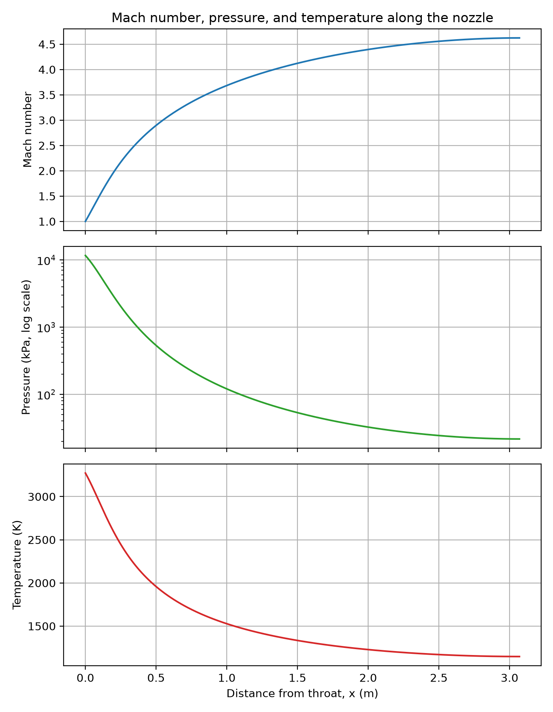
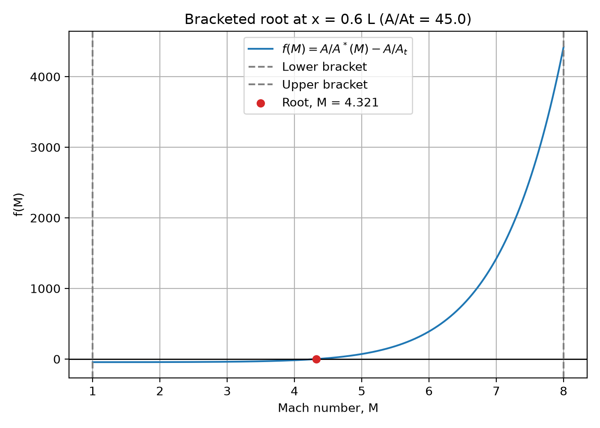

# RS-25 Nozzle and Compressible Flow Solver

A Python solver for steady, one-dimensional, isentropic supersonic flow through an approximate RS-25 (Space Shuttle Main Engine) nozzle, from the throat to the exit. The solver finds the supersonic Mach number at each station from the area-Mach relation using a bracketing root finder (Brent's method). It then computes pressure, temperature, density and velocity. The model's thrust, specific impulse, mass flow and throat size are compared with public RS-25 values.



## Method

1. **Geometry.** The exit area comes from the exit diameter. The throat area is the exit area divided by the area ratio. Area grows from throat to exit along a smooth cubic, `A(x) = At [1 + (Ae/At - 1)(3 xi^2 - 2 xi^3)]` with `xi = x/L`. This is a simple stand-in shape, not the real RS-25 contour.
2. **Mach number.** At each station the solver solves

   `A/A* = (1/M) [ (2/(gamma+1)) (1 + (gamma-1)/2 M^2) ]^((gamma+1)/(2(gamma-1)))`

   for the supersonic root. It uses `scipy.optimize.brentq` with the bracket `1.000001 < M < 10`. The throat (`A/A* = 1`) is set to `M = 1`.
3. **Flow properties.** These come from the isentropic relations with stagnation conditions `P0`, `T0`: `T = T0 / (1 + (gamma-1)/2 M^2)`, `P = P0 (T/T0)^(gamma/(gamma-1))`, `rho = P/(R T)`, `V = M sqrt(gamma R T)`.
4. **Performance.** Mass flow is the choked-flow value at the throat. Vacuum thrust is `F = mdot Ve + Pe Ae`, and vacuum Isp is `F / (mdot g0)`.



## Assumptions

- Steady, 1-D, isentropic flow of a calorically perfect gas (constant `gamma` and `R`). No friction, heat transfer, shocks, chemistry or boundary layer.
- The throat is choked and the flow is fully supersonic and attached all the way to the exit. Separation is ignored.
- Chamber stagnation conditions are used as the throat-inlet stagnation state. Losses in the injector and combustion chamber are ignored.
- The nozzle contour is the cubic shape above, not the real bell contour.
- Vacuum thrust only. Ambient pressure is zero.

## Inputs

| Input | Value used | Source |
|---|---|---|
| Chamber pressure `P0` | 2,994 psi (20.64 MPa) | RS-25 infobox, 109% power level [1] |
| Exit area ratio `Ae/At` | 69 | RS-25 nozzle section ("about 69:1") [1]. The same page's infobox gives 78:1. See the notes below. |
| Exit diameter `De` | 2.30 m | 90.7 in, RS-25 nozzle section [1, 3] |
| Nozzle length `L` | 3.07 m | 121 in, RS-25 nozzle section [1, 3] |
| Chamber temperature `T0` | 3,600 K | Rounded. The source gives 3,300 °C (about 3,573 K) [1, 4] |
| Ratio of specific heats `gamma` | 1.20 | Modeling assumption, no source |
| Gas constant `R` | 355 J/(kg K) | Modeling assumption, no source |

## Results

Run with the inputs above (`python rs25_nozzle_solver.py`).

**Computed exit-plane values.** I found no public reference for these, so they are not compared.

| Exit Mach | Exit pressure | Exit temperature | Exit density | Exit velocity |
|---|---|---|---|---|
| 4.624 | 21.6 kPa | 1,147 K | 0.0531 kg/m^3 | 3,232 m/s |

**Comparison with public RS-25 values** (percent difference = (model - reference) / reference):

| Quantity | Model | Reference | Difference | Reference source |
|---|---|---|---|---|
| Vacuum thrust | 2,395 kN | 2,279 kN (512,300 lbf) | +5.1% | Infobox, 109% power level [1, 2] |
| Vacuum Isp | 342.5 s | 452.3 s | -24.3% | Infobox, 109% power level [1, 2] |
| Mass flow | 713.1 kg/s | 514.49 kg/s | +38.6% | Infobox [1, 2] |
| Throat diameter | 0.277 m | 0.262 m (10.3 in) | +5.8% | Nozzle section [1, 3] |

The model's vacuum thrust is 5.1% above the reference. The other compared values are further off. Thrust comes out closer than mass flow or Isp because two errors partly cancel: the model's mass flow is too high and its exhaust velocity is too low.

## Discrepancy notes

- **Gas constant.** `R = 355 J/(kg K)` implies a mean molar mass of 8314.46 / 355 = 23.4 kg/kmol. LOX/LH2 at O/F 6.03 is fuel-rich, so the products are mostly H2O (18.0 kg/kmol) and leftover H2 (2.0 kg/kmol). The mean molar mass must therefore be below 18. A rough complete-combustion estimate (no dissociation) at O/F 6.03 gives 14.2 kg/kmol, or R = 587 J/(kg K). In this model mass flow scales as `1/sqrt(R)` and exhaust velocity as `sqrt(R)`, so the low `R` explains most of the Isp and mass-flow error. It does not change thrust, because `F = Cf P0 At` does not depend on `R`.
- **Area ratio.** The reference page lists both 69:1 and 78:1. The published throat and exit diameters give (90.7 / 10.3)^2 = 77.5. With 69:1 and a 2.30 m exit, the model's throat comes out 5.8% larger than the published 10.3 in.
- **Physics left out.** Real RS-25 exhaust has varying `gamma` and shifting chemical equilibrium. The real nozzle also has boundary-layer and divergence losses. A 1-D frozen-gas model with constant properties does not capture any of this.

The script also prints a one-at-a-time sensitivity check. These cases are for diagnosis only, not tuned results:

| Case | Thrust diff | Isp diff | Mass flow diff |
|---|---|---|---|
| Baseline (inputs above) | +5.1% | -24.3% | +38.6% |
| R = 586.7 J/(kg K) (complete-combustion estimate) | +5.1% | -2.7% | +7.8% |
| Ae/At = 77.5 (from published diameters) | -6.1% | -24.0% | +23.3% |

## How to run

Requires Python 3.10 or newer. From the project folder in PowerShell:

```powershell
python -m venv .venv
.venv\Scripts\Activate.ps1
python -m pip install -r requirements.txt
python rs25_nozzle_solver.py
python -m unittest -v
```

The script prints the results above and writes the four figures to `figures/`. The tests check the area-Mach function and root finder against an exact value (`A/A* = 1.6875` at `M = 2`, `gamma = 1.4`) and against round trips over a range of Mach numbers.

## Files

- `rs25_nozzle_solver.py`: geometry, area-Mach root finder, flow properties, comparison and plots
- `test_area_mach.py`: unit tests for the area-Mach relation and root finder
- `figures/`: nozzle shape, bracketing plot, Mach/pressure/temperature plot, density/velocity plot

## Sources

Reference values were taken from the Wikipedia article on the RS-25 (accessed 2026-11-08). The article cites the primary sources listed below. I did not open these primary sources directly.

1. "RS-25," Wikipedia. https://en.wikipedia.org/wiki/RS-25. The infobox notes that its performance data are for the RS-25D at 109% of rated power level.
2. Aerojet Rocketdyne, "RS-25 Engine," archived 2014-07-03. https://web.archive.org/web/20140703043723/https://www.rocket.com/rs-25-engine (cited by [1] for thrust, Isp, chamber pressure, mass flow and nozzle ratio).
3. R. A. O'Leary and J. E. Beck, "Nozzle Design," *Threshold*, Pratt & Whitney Rocketdyne, 1992. https://web.archive.org/web/20080316084228/http://www.engineeringatboeing.com/articles/nozzledesign.htm (cited by [1] for nozzle length, throat and exit diameters).
4. S. Roy, "Space Shuttle Main Engine Enhancements," NASA FS-2000-07-159-MSFC, 2000. https://www.nasa.gov/centers/marshall/news/background/facts/ssme.html, and "NASA Relies on Copper for Shuttle Engine," Copper Development Association, 1992 (both cited by [1] for chamber temperature).
5. Pratt & Whitney Rocketdyne, "Space Shuttle Main Engine" (PDF), 2005. https://web.archive.org/web/20120208191620/http://www.pw.utc.com/products/pwr/assets/pwr_SSME.pdf (cited by [1] for the 6.03 mixture ratio).
